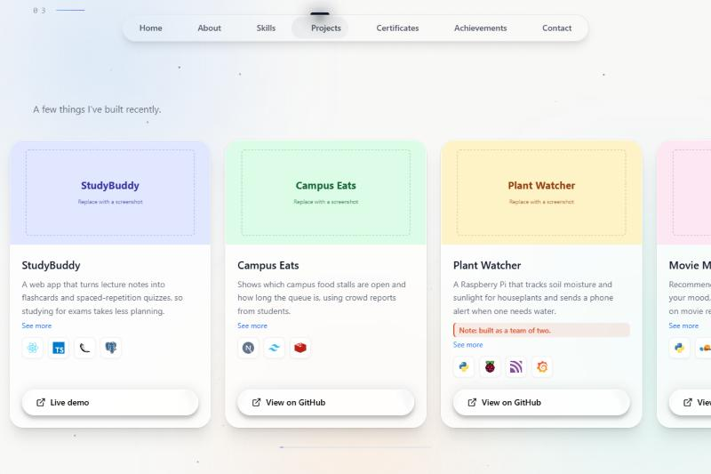
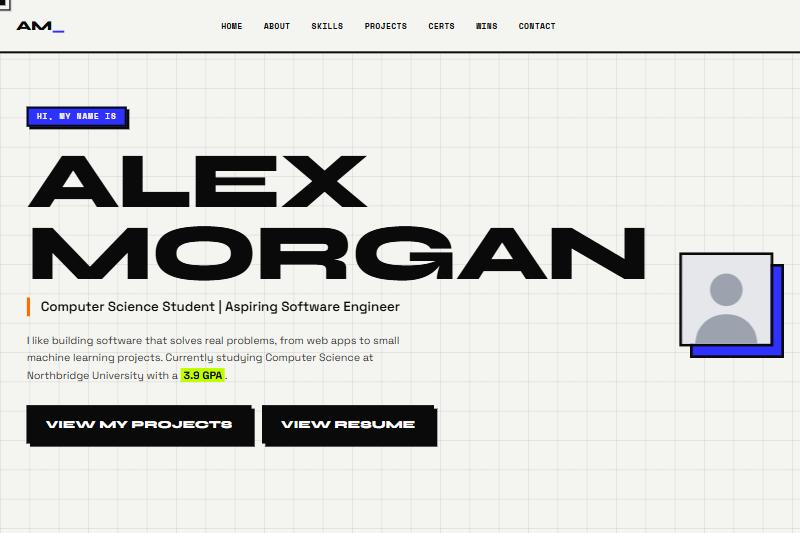

# Portfolio Templates

Two free, open-source personal portfolio sites built with React, Vite and Tailwind CSS. Pick the look you like, change one content file, and deploy.

| Light | Neo-Brutalism |
| --- | --- |
|  |  |
| Soft glassy cards, aurora background, particles, a 3D robot and smooth pinned scrolling. | Thick ink borders, hard offset shadows, loud type and a custom cursor. |
| [`light/`](light) | [`neobrutalism/`](neobrutalism) |

Both templates show the same sections: hero, about (education timeline and activities), skills, projects, certificates, achievements and a contact form. They ship with a made-up sample person, Alex Morgan, so you can see the site working before you change anything.

## Quick start

You need [Node.js](https://nodejs.org) 18 or newer.

```bash
cd light            # or: cd neobrutalism
npm install
npm run dev         # opens on http://localhost:5173
```

## Make it yours

Almost everything you need to change is in one file: `src/data/content.js`.

1. **Your details**: name, role, bio, social links, contact email and the nav logo text (`profile`, `heroBio`, `aboutIntro`, `contactBio`).
2. **Sections**: `timeline` (education), `leadershipCards`, `skillCategories`, `projects`, `certificates` and `achievements`. Add, remove or reorder items freely.
3. **Images**: put your photos and screenshots in `public/images/` and reference them with `img("your-file.png")`. The sample images are SVG placeholders that say "Replace with…".
4. **Resume**: replace `public/resume.pdf` with your own.
5. **Tab title and icon**: edit the `<title>` in `index.html` and replace `public/favicon.svg`.

Tech icons load from [devicon](https://devicon.dev) and [Simple Icons](https://simpleicons.org); `content.js` has helpers for both.

The contact form opens the visitor's email app with the message filled in. No backend or API key is needed.

## Deploy

Each folder is a normal static Vite site. Run `npm run build` and upload the `dist/` folder anywhere.

- **Vercel / Netlify**: import the repo and set the root directory to `light` or `neobrutalism`. Build command `npm run build`, output directory `dist`.
- **GitHub Pages**: this repo includes `.github/workflows/deploy-demos.yml`, which builds both templates and publishes them as live demos. In your repo, go to **Settings → Pages** and set **Source** to **GitHub Actions**, then push to `main`. If you only keep one template, delete the other folder and its build step in the workflow.
- **Project sites** (`username.github.io/repo-name/`) need the base path set at build time: `BASE_PATH=/repo-name/ npm run build`. Custom domains and user sites use the default `/`.

The sites use hash routing (`/#/`), so they work on any static host without rewrite rules.

## Notes

- The light theme is heavy on purpose (3D robot, particles, GSAP scroll effects). If you want it faster, remove `RobotSection` from `src/pages/Home.jsx` and the `AuroraBackground` / `Particles` lines from `src/Layout.jsx`.
- The 3D robot is loaded from a public [Spline](https://spline.design) scene URL in `src/sections/RobotSection.jsx`. You can swap in your own Spline scene there.
- `src/components/ui/` contains [shadcn/ui](https://ui.shadcn.com) components (many unused) and a few components adapted from open community UI libraries.

## License

[MIT](LICENSE). Use it for your own portfolio, change anything, no credit required (but a star is nice).
